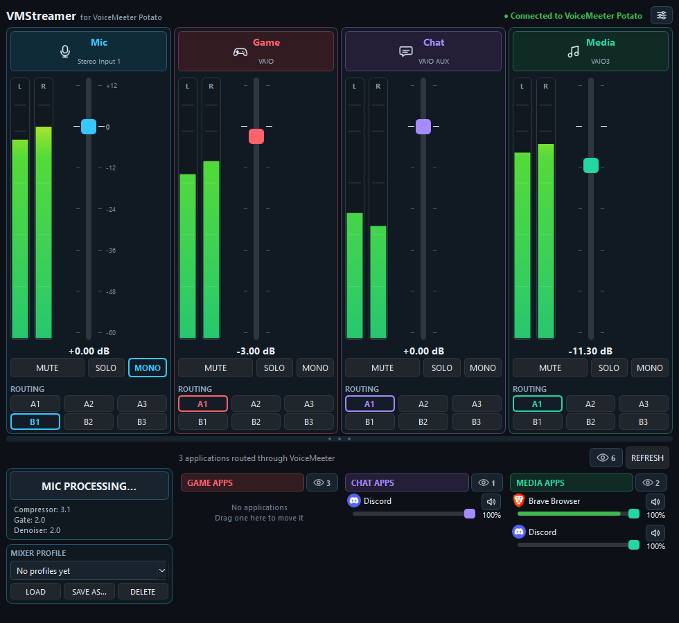

# VMStreamer

A modern, lightweight control panel for **VoiceMeeter Potato**, designed for streamers and content creators.

VMStreamer provides a clean interface for managing your microphone, mixer channels, Windows application audio, and microphone processing without constantly switching back to the VoiceMeeter interface.

## Preview



## Features

### Mixer Control

Control your main VoiceMeeter channels directly from VMStreamer:

- Microphone
- Game
- Chat
- Media
- Volume / gain control
- Mute
- Solo
- Mono
- Output routing buttons A1–A3 and B1–B3 on every channel, shown with the bus names you gave them in VoiceMeeter
- Mixer profiles: save gain, mute, solo, mono and routing of all channels under a name, and load them again
- Live level meters on every channel, with a dB scale on the faders
- Reconnects by itself when VoiceMeeter is closed and started again
- Global hotkeys to mute the microphone (Ctrl+Shift+M by default) and each of Game, Chat and Media
- System tray icon: keeps running when the window is closed, with mute and quit in its menu
- Settings window for the microphone input, the hotkey and the tray behaviour
- Starting VMStreamer a second time shows the running one instead of opening another
- `VMStreamer.exe --quit` asks the running VMStreamer to quit, for use in scripts
- Draggable divider between the mixer and the lower panels

### Application Audio

VMStreamer automatically detects Windows audio sessions and displays applications routed through VoiceMeeter.

Applications are grouped according to their VoiceMeeter output:

- **Game** — VoiceMeeter VAIO
- **Chat** — VoiceMeeter VAIO AUX
- **Media** — VoiceMeeter VAIO3

Each application provides:

- Application icon
- Individual volume control
- Mute control
- Live audio level indication
- Automatic session detection and a Refresh button

### Moving Applications

Drag an application onto another column to move its audio to that channel. This sets the per-application output device in Windows, so it persists. Windows switches the application when it next starts playback; until then it is shown as moving.

### Hiding Applications

Hiding is per channel: an application can be hidden on Game and still be visible on Chat.

- **Hide applications:** Right-click any application and select **Hide on <channel>** or **Hide on all channels**. Hidden applications are remembered between launches.
- **Unhide applications:** Click the **eye button** in a column header (or the one next to Refresh, for all channels) to show hidden applications, then right-click the application and select **Unhide**.

### Microphone Processing

VMStreamer provides direct control over VoiceMeeter's microphone processing.

#### Compressor

- Compression amount
- Input gain
- Ratio
- Threshold
- Attack
- Release
- Knee
- Output gain
- Auto makeup

#### Gate

- Gate amount
- Threshold
- Damping
- Sidechain
- Attack
- Hold
- Release

#### Denoiser

- Denoiser amount

All processing controls are synchronized directly with VoiceMeeter.

The Mic Processing window also provides:

- A mic input level bar with the gate and compressor thresholds marked on it
- **Bypass** per block, to compare with and without; all values are remembered and restored
- **Reset**, which restores the values from when the window was opened
- **Presets**: save the compressor, gate and denoiser values together under a name, and load them again
- Logarithmic Attack, Hold and Release sliders, and a tooltip on every parameter

Note: in VoiceMeeter, **Amount** is a preset dial. Moving it replaces the advanced values of that block.

### Live Audio Meters

VMStreamer includes real-time audio monitoring for:

- Microphone, Game, Chat and Media
- Windows applications

Application audio monitoring uses a dedicated sampling loop to keep the interface responsive and prevent audio metering from blocking the graphical interface.

## Requirements

- Windows 10 / Windows 11
- VoiceMeeter Potato
- Python 3.14+ for running from source

### Python Dependencies

- PySide6
- voicemeeter-api
- pycaw
- comtypes
- psutil
- winappaudiorouter (moving applications between channels)

## Running From Source

Clone the repository:

```powershell
git clone https://github.com/GuylianDeJong/VMStreamer.git
cd VMStreamer
```

Create a virtual environment:

```powershell
python -m venv .venv
```

Activate it:

```powershell
.\.venv\Scripts\Activate.ps1
```

Install the required dependencies:

```powershell
pip install -r requirements.txt
```

Run VMStreamer:

```powershell
python main.py
```

## Running the Tests

The tests use only the Python standard library and run without VoiceMeeter: the mixer, the registry and Windows audio are replaced by stand-ins.

```powershell
.\.venv\Scripts\python.exe -m unittest discover -s tests
```

## Building the Windows EXE

VMStreamer can be packaged into a standalone Windows executable using PyInstaller.

Run the build script from the project folder. It installs PyInstaller into the virtual environment when needed:

```powershell
.\build_vmstreamer.ps1
```

The resulting executable will be located at:

```text
dist\VMStreamer.exe
```

## Troubleshooting

VMStreamer writes errors to a log file, which is the place to look when something does not work in the packaged build:

```text
%LOCALAPPDATA%\VMStreamer\vmstreamer.log
```

## Project Structure

```text
VMStreamer/
├── main.py                   application source
├── vmstreamer_launcher.py    entry point of the packaged EXE
├── build_vmstreamer.ps1      builds dist\VMStreamer.exe
├── requirements.txt
├── tests/                    unit tests (no VoiceMeeter needed)
├── vmstreamer.ico
├── HANDOVER.md
├── PROJECT_STATE.md
└── README.md
```

Build files, the Python virtual environment, and other generated files are intentionally excluded from Git.

## VoiceMeeter Configuration

VMStreamer currently works with **VoiceMeeter Potato** and uses the following channels:

| VMStreamer | VoiceMeeter | Windows Device |
| --- | --- | --- |
| Mic | Hardware Input 1 | Focusrite / microphone |
| Game | Virtual Input 1 (VAIO) | VoiceMeeter VAIO |
| Chat | Virtual Input 2 (AUX) | VoiceMeeter VAIO AUX |
| Media | Virtual Input 3 (VAIO3) | VoiceMeeter VAIO3 |

The microphone's hardware input (1 to 5) can be chosen in Settings and is used after a restart. The Game, Chat and Media mapping is fixed in `main.py` (`STRIPS`).

Windows applications routed through these VoiceMeeter devices are automatically detected and displayed in the corresponding VMStreamer section.

## Application Design

VMStreamer is built with:

- Python
- PySide6 / Qt
- voicemeeter-api
- pycaw
- Windows Core Audio

The application uses separate worker threads for Windows application audio monitoring and VoiceMeeter level monitoring so that audio processing does not block the graphical interface.

## Status

VMStreamer is currently under active development.

The core mixer, microphone processing, application routing, live audio meters, and Windows application volume controls are functional.

## Roadmap

Done so far: reconnect, meters on every channel, global mute hotkeys, system tray, settings window, mic processing presets, mixer profiles, single running instance.

Next, roughly in this order:

1. Hotkeys for volume and for switching profiles
2. A compact window mode
3. Configurable Game, Chat and Media mapping, and other VoiceMeeter editions
4. A local API, so Stream Deck, OBS and scripts can control VMStreamer
5. A Windows installer and a signed EXE

Not planned for now: light mode and custom themes, automatic updates.

## Support

If you find VMStreamer useful and would like to support its development:

[](https://ko-fi.com/guyliandejong)


## License

VMStreamer is licensed under the VMStreamer Non-Commercial License.

You are free to use, modify, fork, and redistribute VMStreamer for personal and non-commercial purposes.

Commercial use, sale, or redistribution of VMStreamer or modified versions for commercial purposes requires prior written permission from the author.

VMStreamer is an independent third-party project and is not affiliated with or endorsed by VB-Audio Software.
