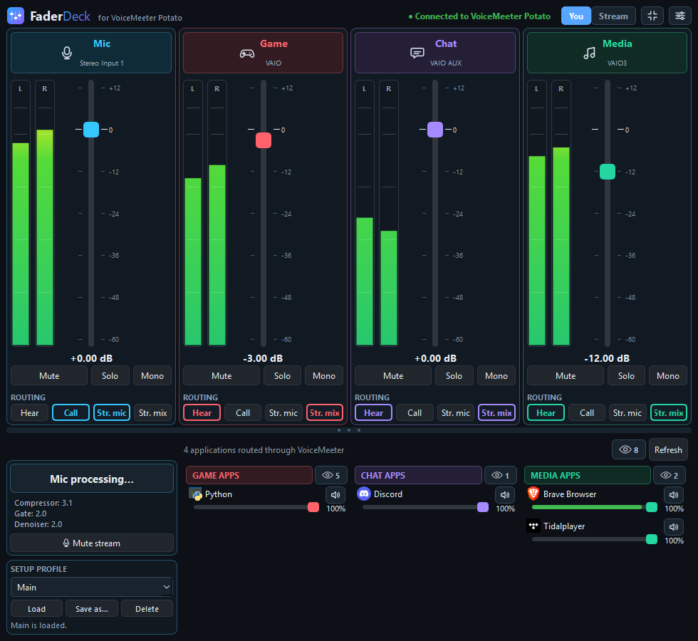
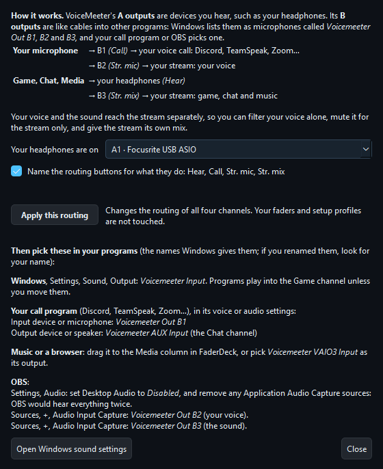
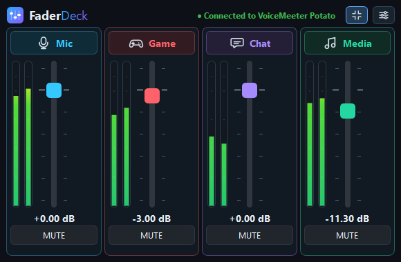
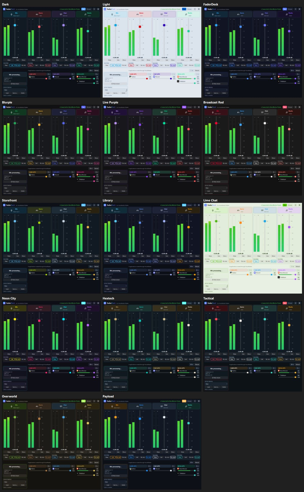
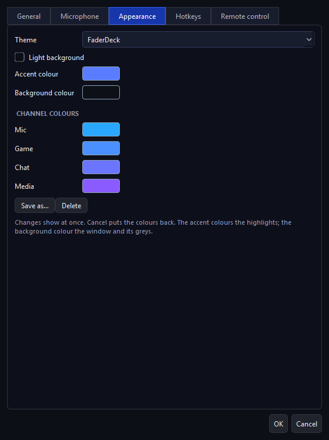
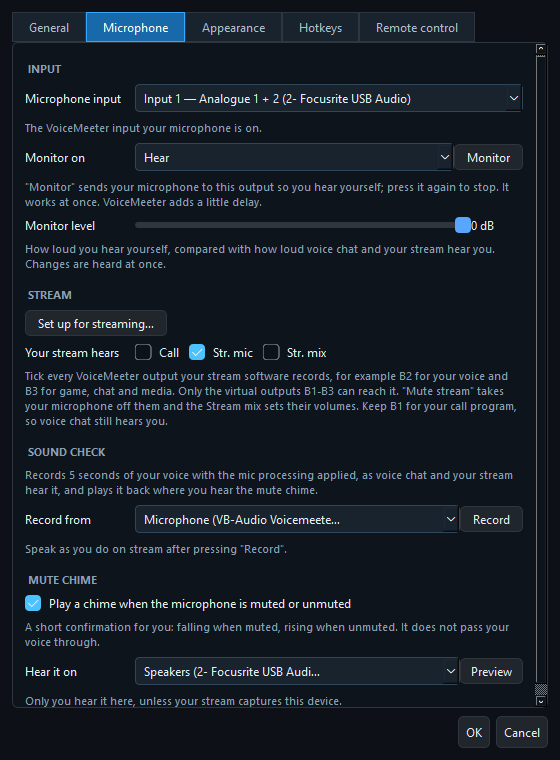
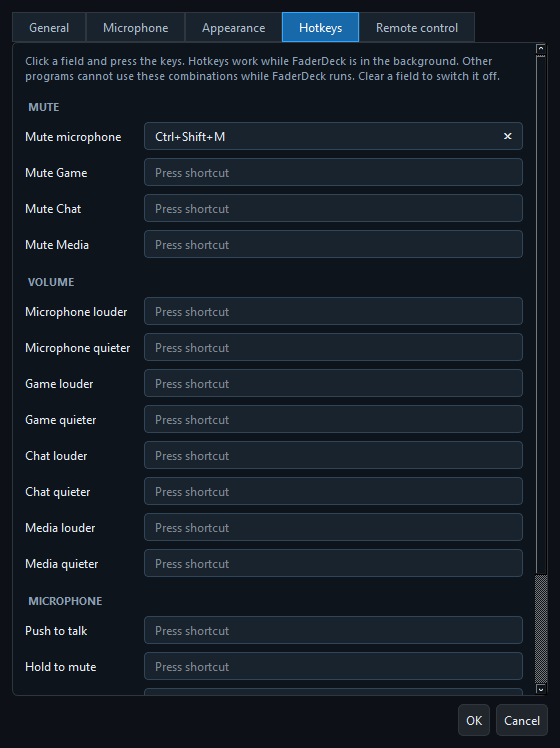
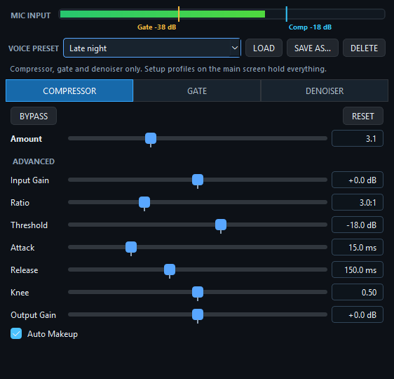

# FaderDeck

*Formerly VMStreamer. Renamed in v1.5.0 so it is not mistaken for VB-Audio's own VM-Streamer View; your settings carry over.*

A modern, lightweight control panel for **VoiceMeeter Potato**, designed for streamers and content creators.

FaderDeck provides a clean interface for managing your microphone, mixer channels, Windows application audio, and microphone processing without constantly switching back to the VoiceMeeter interface.

## Install

Download **FaderDeck-Setup.exe** from the [latest release](https://github.com/GuyliandeJong/FaderDeck/releases/latest) and run it. It installs for your Windows account only, so it does not ask for administrator rights, and it can start FaderDeck with Windows. Uninstall it from Windows Settings, Apps.

Windows may warn that the program is not signed; choose **More info**, then **Run anyway**.

Prefer no installer? The release also has **FaderDeck.exe**, which runs as it is. That copy does not update itself.

## First Start

The first time FaderDeck opens, a short welcome recommends the **streaming setup** (also under Settings, Microphone): one click sends your voice to your call and your stream and your sound to your headphones and your stream, and it tells you what to pick in your call program and OBS.

## Preview



## Features

### Mixer Control

Control your four VoiceMeeter channels directly from FaderDeck: Microphone, Game, Chat and Media.

- Fader with a dB scale, and live level meters on every channel
- Scroll on a fader for 0.1 dB steps (1 dB with Shift); double right-click puts it back at 0 dB
- Mute, Solo and Mono
- A soft sound when the microphone is muted or unmuted, so you hear it without looking. Choose the device it plays on, such as your headphones, so your stream does not pick it up; or switch it off
- Output routing A1–A3 and B1–B3, shown with the bus names you gave them in VoiceMeeter
- Your own names for Game, Chat and Media (Settings, General), for example "Music" instead of "Media"
- Reconnects by itself when VoiceMeeter is closed and started again
- A draggable divider between the mixer and the lower panels

### Stream Mix

Give your viewers a different mix than you hear: music quieter on stream, game louder for you. Once your stream has an output of its own (Settings, Microphone, Your stream hears), a **You / Stream** switch appears in the header. The faders then set what you hear or what your stream hears. Setup profiles keep both mixes, and the phone remote has its own switch.

For this, your stream must take its sound from VoiceMeeter's outputs only. A setup that works well:

| Output | Carries | Used by |
| --- | --- | --- |
| B1 | your microphone | Discord |
| B2 | your microphone | OBS, as the microphone source |
| B3 | Game, Chat and Media | OBS, as the sound source (instead of Desktop Audio or application capture) |

**Settings, Microphone, Set up for streaming** does all of this in one click and lists what to pick in Windows, your call program and OBS, by the names Windows gives the VoiceMeeter devices. By hand: tick B2 and B3 under Settings, Microphone, Your stream hears. Mute stream then takes your voice off B2 while your call keeps it, the Stream mix sets the volumes on B2 and B3, and in OBS your voice and the game sound stay separate sources with their own filters and recording tracks. In the Stream mix, a channel that reaches none of the stream's outputs says "not sent to B2 or B3".



FaderDeck does this with VoiceMeeter's volume per output. VoiceMeeter's own main faders then no longer show the volumes; moving one there resets the stream mix of that channel.

### Compact View

A button in the header shrinks the window to the four channels with fader, meters, level and Mute. It fits in 520×300, remembers its own size and place, and FaderDeck starts in the view it was closed in. Hotkeys and profiles keep working.



### Themes and Colours

Under Settings, Appearance you choose how FaderDeck looks, and every change shows at once; Cancel puts the old colours back.

- Built-in themes: **Dark**, **Light**, and **FaderDeck**, which follows the logo's blue-to-purple gradient across the four channels
- Themes in the colours of popular apps and games: **Blurple**, **Live Purple**, **Broadcast Red**, **Storefront**, **Library**, **Lime Chat**, **Neon City**, **Hextech**, **Tactical**, **Overworld** and **Payload**
- An accent colour for the highlights, and a background colour for the window's backgrounds and greys
- A colour of your own for each channel, to match your setup
- **Save as** keeps your colours as a theme of your own, to switch back to later





### Automatic Updates

The installed FaderDeck checks for a new version when it starts and offers to install it. The update is checked against the fingerprint GitHub publishes for it before it runs; FaderDeck closes, updates and starts again. Switch the check off, or check by hand, under Settings, General.

### Setup Profiles

Save your whole setup under a name and load it again with one click: gain, mute, solo, mono and routing of all channels, and the microphone processing.

- The panel shows when the mixer no longer matches the loaded profile, with **Update** to save the current state back into it
- The loaded profile is remembered between launches

### Microphone Controls

- **Push to talk**: hold a hotkey to talk; let go and the microphone is muted again
- **Hold to mute**: hold a hotkey to cough or sneeze without being heard
- **Monitor**: hear your own microphone on your headphones
- **Mute stream**: mute your microphone for the stream only, while voice chat still hears you
- **Monitor level**: hear yourself quieter than others hear you (Settings, Microphone)
- **Sound check**: record five seconds of your voice with the mic processing applied, as voice chat and your stream hear it, and hear it back (Settings, Microphone)

Monitor is a button in Settings, Microphone, under the microphone input. Mute stream is a button under Mic Processing. Both are also in the tray menu and on the phone remote, and Mute stream has a hotkey. Choose under Settings, Microphone which output you monitor on and which one your stream hears. Mute stream only works when your stream software takes the microphone from an output of its own: in OBS, use VoiceMeeter Out B2 for the microphone and keep B1 for Discord (see Stream Mix for a full setup).



### Global Hotkeys

Hotkeys work while FaderDeck is in the background or hidden in the tray. Set them under Settings, Hotkeys.

- Mute for every channel (the microphone's is Ctrl+Shift+M out of the box)
- Louder and quieter for every channel, 1 dB per press
- Next and previous setup profile
- Push to talk, hold to mute, and mute stream



A hotkey is taken from every other program while FaderDeck runs, so pick combinations you do not use elsewhere. When another program already has one, FaderDeck tells you at start and marks it in Settings, Hotkeys.

### System Tray

- Closing the window keeps FaderDeck running in the tray; click the icon to show it again
- The tray menu has Show, Mute microphone and Quit
- Hold Shift while closing the window to quit at once
- Optional: start minimised to the tray
- Starting FaderDeck a second time shows the running one instead of opening another

### Phone and Tablet Remote

Use a phone or tablet on your home network as a mixing console: a fader per channel, mute, monitor, mute stream and your setup profiles, in your own channel names and colours. It works in any browser, on Android, iPhone and tablets, and needs nothing installed.

1. In Settings, Remote control, tick **Allow phones and tablets on my home network**.
2. Press **Allow through firewall** and say yes to the Windows prompt. Without it, Windows blocks the phone and the page times out.
3. Open the address shown there on the phone, press **Pair a device** on the PC and type the code.
4. Use the browser's **Add to home screen** to keep it as an app.

Only paired devices on your own network can control FaderDeck; **Forget paired devices** removes them all. The page updates itself when FaderDeck is updated.

### Stream Deck

The FaderDeck plugin for the Elgato Stream Deck has keys for **Mute** (per channel), **Volume**, **Monitor**, **Mute stream** and **Setup profile**. Mute, Monitor and Mute stream keys light up to show the state, also when you change it on the PC. On a Stream Deck+ dial, turn for volume and press to mute, with the volume on the display.

1. Download **FaderDeck.streamDeckPlugin** from the [latest release](https://github.com/GuyliandeJong/FaderDeck/releases/latest) and open it; the Stream Deck app installs it.
2. In FaderDeck, Settings, Remote control: tick **Allow control by other programs**.
3. Put a FaderDeck key on your deck and copy the port and token from FaderDeck into it. All FaderDeck keys share them.

### Remote Control

Other programs on the same PC, such as Stream Deck plugins and OBS scripts, can control FaderDeck. It is off by default. The requests are listed under [Remote Control](#remote-control-1) further down.

### Application Audio

FaderDeck automatically detects Windows audio sessions and displays applications routed through VoiceMeeter.

Applications are grouped according to their VoiceMeeter output:

- **Game** — VoiceMeeter VAIO
- **Chat** — VoiceMeeter VAIO AUX
- **Media** — VoiceMeeter VAIO3

Each application provides:

- Application icon
- Individual volume control
- Mute control
- Live audio level indication
- Automatic session detection and a Refresh button

### Moving Applications

Drag an application onto another column to move its audio to that channel. This sets the per-application output device in Windows, so it persists. Windows switches the application when it next starts playback; until then it is shown as moving.

### Hiding Applications

Hiding is per channel: an application can be hidden on Game and still be visible on Chat.

- **Hide applications:** Right-click any application and select **Hide on <channel>** or **Hide on all channels**. Hidden applications are remembered between launches.
- **Unhide applications:** Click the **eye button** in a column header (or the one next to Refresh, for all channels) to show hidden applications, then right-click the application and select **Unhide**.

### Microphone Processing

FaderDeck provides direct control over VoiceMeeter's microphone processing.



#### Compressor

- Compression amount
- Input gain
- Ratio
- Threshold
- Attack
- Release
- Knee
- Output gain
- Auto makeup

#### Gate

- Gate amount
- Threshold
- Damping
- Sidechain
- Attack
- Hold
- Release

#### Denoiser

- Denoiser amount

All processing controls are synchronized directly with VoiceMeeter.

The Mic Processing window also provides:

- A mic input level bar with the gate and compressor thresholds marked on it
- **Bypass** per block, to compare with and without; all values are remembered and restored
- **Reset**, which restores the values from when the window was opened
- **Voice presets**: save the compressor, gate and denoiser values together under a name, and load them again. They hold the processing only; a setup profile holds everything
- Logarithmic Attack, Hold and Release sliders, and a tooltip on every parameter

Note: in VoiceMeeter, **Amount** is a preset dial. Moving it replaces the advanced values of that block.

### Live Audio Meters

FaderDeck includes real-time audio monitoring for:

- Microphone, Game, Chat and Media
- Windows applications

Application audio monitoring uses a dedicated sampling loop to keep the interface responsive and prevent audio metering from blocking the graphical interface.

## Requirements

- Windows 10 / Windows 11
- VoiceMeeter Potato
- Python 3.14+ for running from source

### Python Dependencies

- PySide6
- voicemeeter-api
- pycaw
- comtypes
- psutil
- winappaudiorouter (moving applications between channels)

## Running From Source

Clone the repository:

```powershell
git clone https://github.com/GuylianDeJong/FaderDeck.git
cd FaderDeck
```

Create a virtual environment:

```powershell
python -m venv .venv
```

Activate it:

```powershell
.\.venv\Scripts\Activate.ps1
```

Install the required dependencies:

```powershell
pip install -r requirements.txt
```

Run FaderDeck:

```powershell
python main.py
```

## Remote Control

FaderDeck can be controlled by other programs on the same computer over HTTP. Switch it on under Settings, Remote control, and copy the token shown there.

- It listens on `127.0.0.1` only, so nothing on the network can connect.
- Every request needs the token, in the header `X-FaderDeck-Token`.
- Requests from web pages are refused.

| Request | Does |
| --- | --- |
| `GET /api/state` | connection, loaded profile, and gain, mute, solo, mono and routing of every channel |
| `GET /api/profiles` | the setup profiles and which one is loaded |
| `POST /api/mute/mic?state=toggle` | mute a channel: `on`, `off` or `toggle` |
| `POST /api/gain/game?step=-1` | move a fader by decibels, or set it with `db=-6`; add `mix=stream` for the stream mix |
| `POST /api/profile/Streaming` | load a setup profile |
| `POST /api/profile?step=next` | load the `next` or `previous` profile |
| `POST /api/monitor?state=toggle` | hear your own microphone: `on`, `off` or `toggle` |
| `POST /api/stream-mute?state=toggle` | mute the microphone for the stream only |

Channels are `mic`, `game`, `chat` and `media`. Example:

```powershell
curl.exe -X POST -H "X-FaderDeck-Token: YOUR_TOKEN" http://127.0.0.1:8765/api/mute/mic
```

## Running the Tests

The tests use only the Python standard library and run without VoiceMeeter: the mixer, the registry and Windows audio are replaced by stand-ins.

```powershell
.\.venv\Scripts\python.exe -m unittest discover -s tests
```

## Building the Windows EXE

FaderDeck can be packaged into a standalone Windows executable using PyInstaller.

Run the build script from the project folder. It installs PyInstaller into the virtual environment when needed:

```powershell
.\build_faderdeck.ps1
```

The resulting executable will be located at:

```text
dist\FaderDeck.exe
```

With [Inno Setup 6](https://jrsoftware.org/isinfo.php) installed, the script then also builds the installer, `dist\FaderDeck-Setup.exe`, from `installer\faderdeck.iss`. Its version is `APP_VERSION` in `main.py`.

## Troubleshooting

FaderDeck writes errors to a log file, which is the place to look when something does not work in the packaged build:

```text
%LOCALAPPDATA%\FaderDeck\faderdeck.log
```

## Project Structure

```text
FaderDeck/
├── main.py                   application source
├── faderdeck_launcher.py    entry point of the packaged EXE
├── build_faderdeck.ps1      builds dist\FaderDeck.exe
├── requirements.txt
├── tests/                    unit tests (no VoiceMeeter needed)
├── faderdeck.ico
├── screenshots/              pictures used in this README
├── tools/make_icon.py        rebuilds faderdeck.ico from the logo in main.py
├── HANDOVER.md
├── PROJECT_STATE.md
└── README.md
```

Build files, the Python virtual environment, and other generated files are intentionally excluded from Git.

## VoiceMeeter Configuration

FaderDeck currently works with **VoiceMeeter Potato** and uses the following channels:

| FaderDeck | VoiceMeeter | Windows Device |
| --- | --- | --- |
| Mic | Hardware Input 1 | Focusrite / microphone |
| Game | Virtual Input 1 (VAIO) | VoiceMeeter VAIO |
| Chat | Virtual Input 2 (AUX) | VoiceMeeter VAIO AUX |
| Media | Virtual Input 3 (VAIO3) | VoiceMeeter VAIO3 |

The microphone's hardware input (1 to 5) can be chosen in Settings and is used after a restart. The Game, Chat and Media mapping is fixed in `main.py` (`STRIPS`).

Windows applications routed through these VoiceMeeter devices are automatically detected and displayed in the corresponding FaderDeck section.

## Application Design

FaderDeck is built with:

- Python
- PySide6 / Qt
- voicemeeter-api
- pycaw
- Windows Core Audio

The application uses separate worker threads for Windows application audio monitoring and VoiceMeeter level monitoring so that audio processing does not block the graphical interface.

## Status

FaderDeck is currently under active development.

The core mixer, microphone processing, application routing, live audio meters, and Windows application volume controls are functional.

## Roadmap

Done so far: reconnect, meters on every channel, global hotkeys for mute, volume and profiles, system tray, settings window, voice presets, setup profiles, single running instance, compact view, remote control, your own channel names, themes with light mode and your own colours, an installer, automatic updates, push to talk and hold to mute, monitor and mute stream, a phone and tablet remote, a separate stream mix, monitor level and sound check, a Stream Deck plugin.

Next, roughly in this order:

1. Support for VoiceMeeter Banana and the standard edition
2. MIDI controllers as physical faders

Postponed: a signed EXE, so Windows does not warn about it. It needs a paid code-signing certificate.

## Support

If you find FaderDeck useful and would like to support its development:

[](https://ko-fi.com/guyliandejong)


## License

FaderDeck is licensed under the FaderDeck Non-Commercial License.

You are free to use, modify, fork, and redistribute FaderDeck for personal and non-commercial purposes.

Commercial use, sale, or redistribution of FaderDeck or modified versions for commercial purposes requires prior written permission from the author.

FaderDeck is an independent third-party project and is not affiliated with or endorsed by VB-Audio Software.
